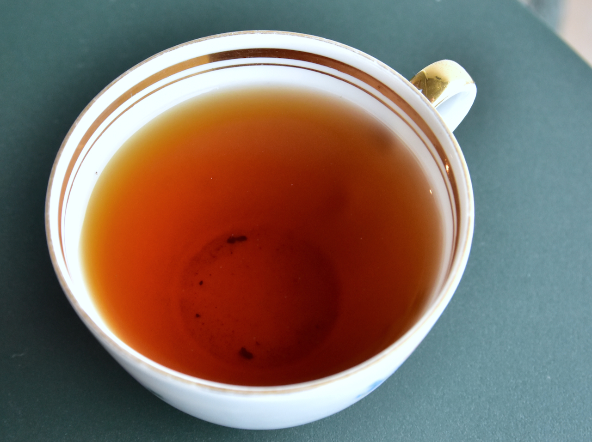
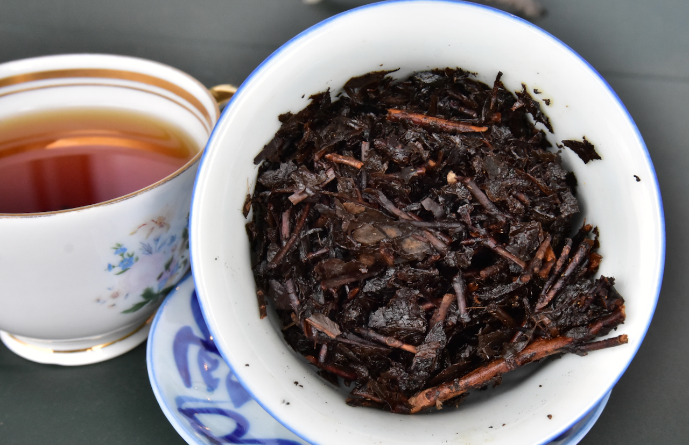
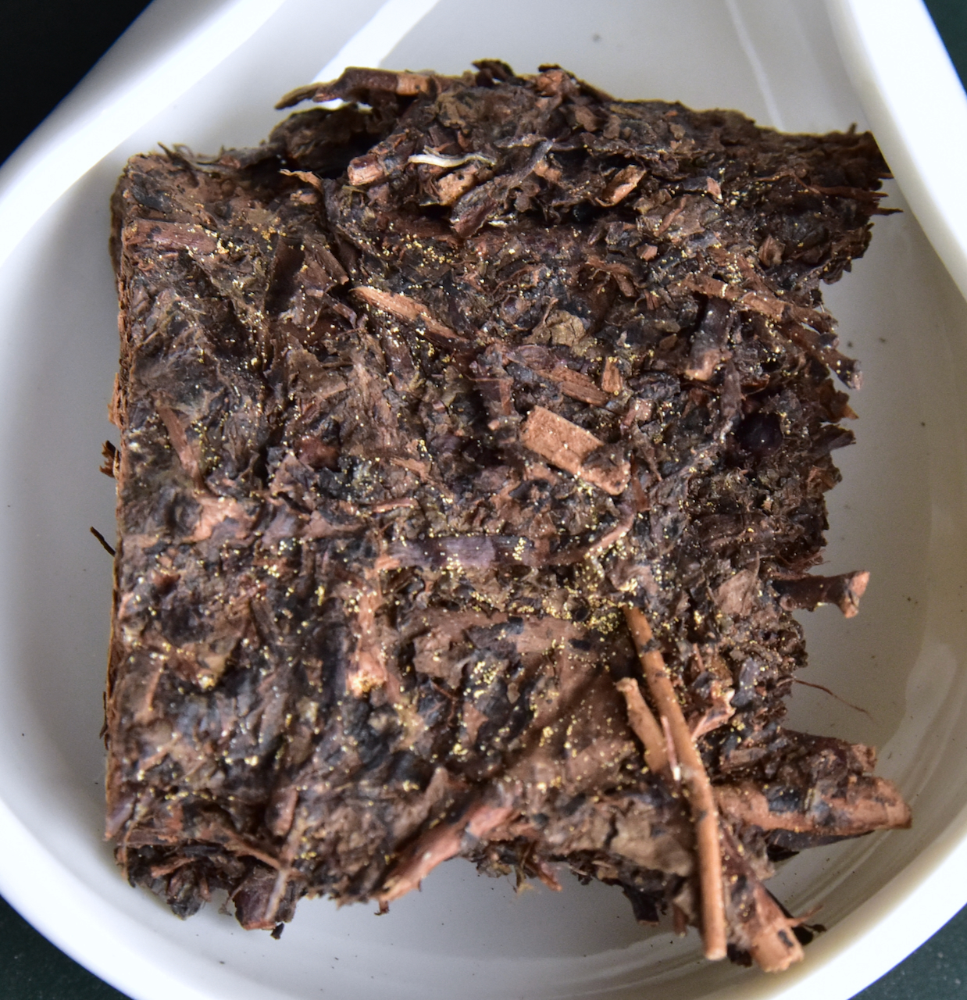
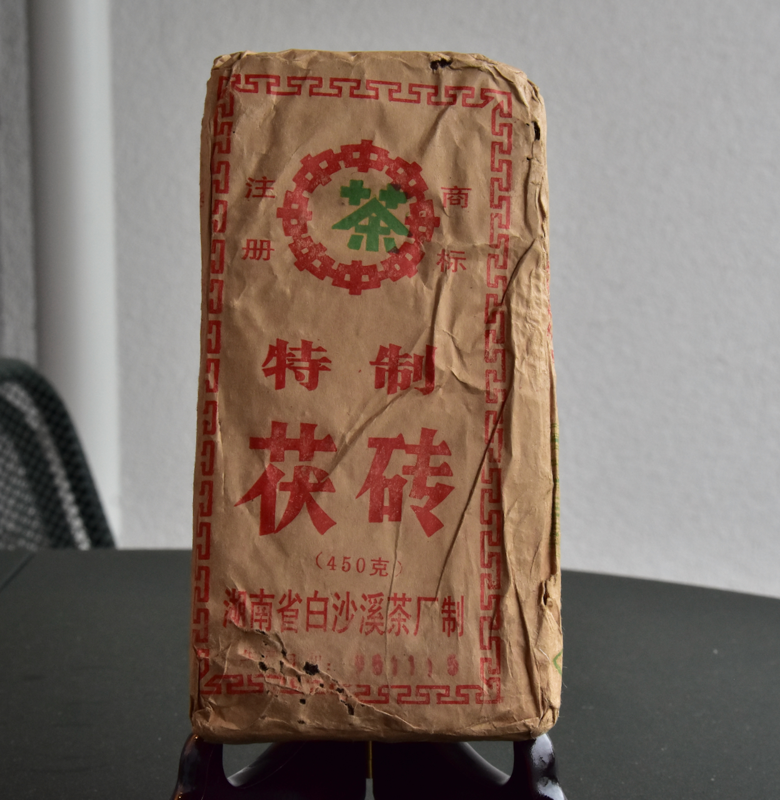
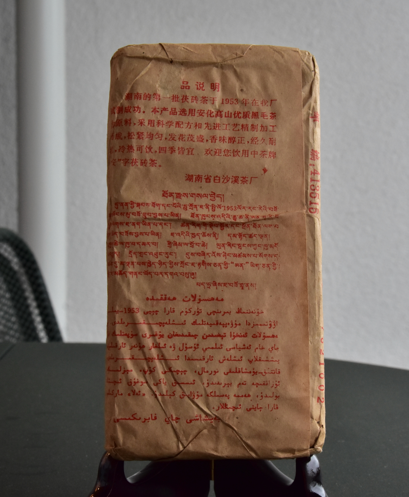
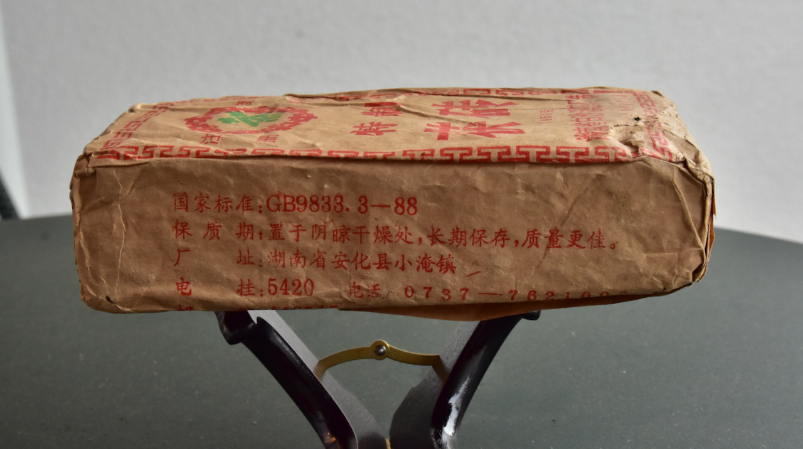
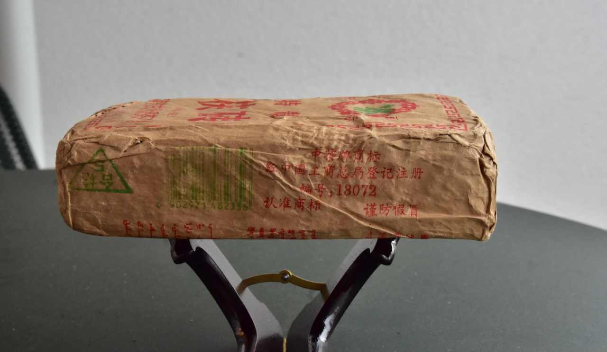

- **Production year:** 1995
- **Storage:** Guangdong (since ~2005)
- **Brick weight:** ~450g (+/- 10%)
- **Price:** USD 100 / brick
- **Availability:** **Out of stock**

---
The vast majority of the 90s "tezhi" fuzhuan productions I've had has been forgettable stuff. Not because of the undeniably crude material (*leaf grade* wise, which is only part of the equation, as i incessantly feel the need to repeat (e.g. see the tagline of this site)) but rather due to the dry storage that became the fate for most of these "边销茶" teas (earmarked for the border regions). The "beggars that became kings" saying hadn't rang true for me, though I was aware this was probably a sample bias from the mostly poorly stored specimens that I had tried. I didn't have high expectations for this tea either, but its strange background story, the favorable comment on it from a person whose tastes I trust to (more often than not) echo my own, the smaller than typical unit size and the (relatively speaking) higher and through recent years _stable_ price tag (90s tezhi fu can often be had very cheaply) of this tea made me gamble on a couple of bricks.

**Baishaxi's (白沙溪)** importance as the first in Hunan to produce fuzhuan tea (1953) and machine pressed fuzhuan (1958) will be known to most of the people reading this. Probably less commonly known is the fact that the company stopped producing fuzhuan tea in 1970, leaving Yiyang (which had been established in 1959 with the specific intent of specializing in this category of tea) as the only Hunan producer of fuzhuan for years. Baishaxi only resumed production in 1985, presumably due to Yiyang having issues meeting the consumer demand on their own.

In any case, the gist of [the strange background story](https://mp.weixin.qq.com/s/pSIY12h-RpuSrODapdQE_A) mentioned above for the particular production on offer here is this:  These bricks are actually the result of bigger 2kg Baishaxi fuzhuan productions from 1992-95 being split in quarters and repackaged as smaller 450 gram offerings. The original bricks whose fate this became were cosmetically defective (there were stringent standards for how these bricks should look), i.e. leftovers from those four production years. Splitting and repackaging became the answer to how to avoid throwing them away. But the bricks repackaged into this unfamiliar format supposedly wasn't welcomed by the market, which led to unsold inventory not budging. In 2005 much of the stock was recalled from border areas to China's "interior" (内地). The specific bricks on offer here ended up in Guangdong where they've been stored for the last 20 years.

*(PS: On the "unfamiliar format", note that this 1995 BSX release was not the first example of a tezhi fuzhuan "quarter brick". There are earlier examples, supposedly from all the three main producers (Yiyang, Baishaxi and Linxiang) and from as early as 1986)*

*(PPS: Since I already mentioned the "beggars that became kings" saying that sometimes accompanies crude heicha that transformed into something really nice, I cannot but emphasize that this is a kind of double whammy brick in it being not only crude but also (compared to its crude fellow tezhi fuzhuan travellers) cosmetically defective. Maybe the ugly duckling is a more apt comparison.)*

A couple of things stand out to me with this tea. The storage has been good. It's mellow while being (for its category) robust, although it still benefits from being pushed a bit. Steep-endurance too is better than the norm for tezhi fuzhuan. Profile wise this reminds me of Furongshan material (I have seen the same regional guess from another person; back when this tea was released actual Anhua material was still used for tezhi fuzhuan productions) that has transformed in a huangjiu-y direction with more woodiness and a bit of hongzao/jujube towards the later steeps. But the strongest quality for me is the body feelings which I'll restrain myself from trying to describe in too much detail. Suffice it to say that the warming and mentally uplifting qualities that I've consistently been getting from this tea are very welcome at this seasonal transition period (where Norway is at its darkest and the cold is setting in).

*

Note: This tea contains golden flowers (Jinhua/金花) which may have been inoculated using wheat flour. Individuals with Celiac Disease or severe gluten allergies should exercise caution.

*

---
